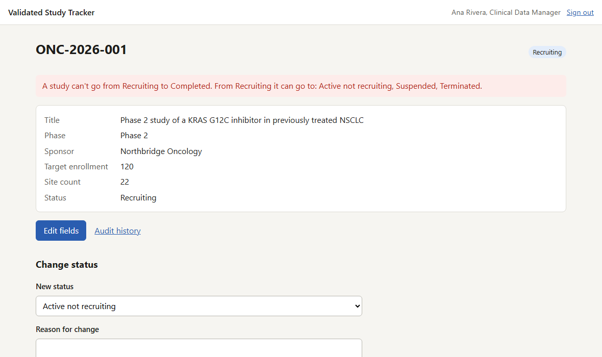
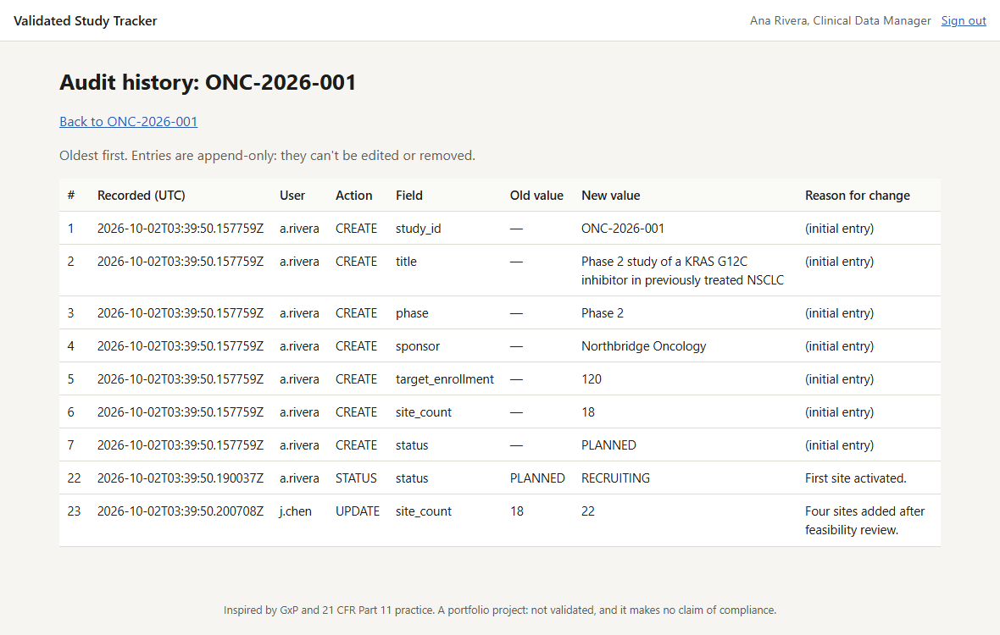
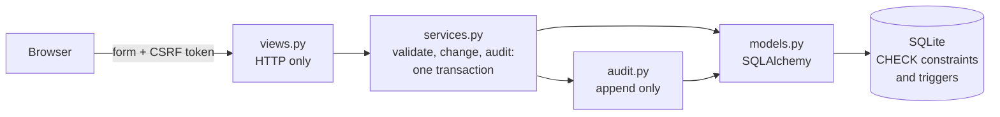
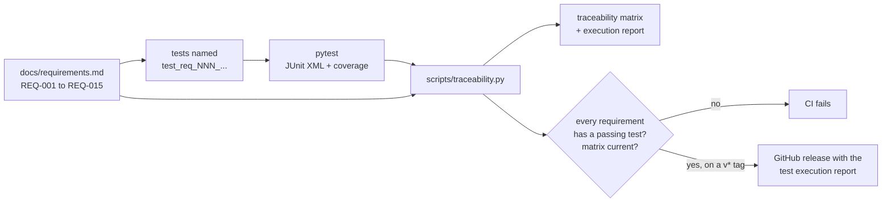

# Validated Study Tracker

[](https://github.com/kartsen03/validated-study-tracker/actions/workflows/ci.yml)
[](https://github.com/kartsen03/validated-study-tracker/releases/latest)

A small web application for managing clinical study records, built the way regulated
software is built: written requirements first, a complete audit trail, and every
requirement traced to automated tests that run in CI. Each release carries a test
execution report for the exact commit it was built from.

> **Inspired by, not compliant with.** The design borrows from GxP practice, in
> particular the audit-trail expectations of FDA 21 CFR Part 11 and the ALCOA+
> data-integrity principles. It is a portfolio project. It has not been validated and
> makes no claim of compliance with Part 11 or any other regulation; the
> [requirements](docs/requirements.md#out-of-scope) list what a validated system would add.

## What it does

- **Study records:** study ID, title, phase, sponsor, target enrollment and site count,
  with field rules enforced on every create and edit.
- **A status lifecycle:** a study starts *Planned* and moves only along allowed
  transitions. *Completed*, *Terminated* and *Withdrawn* are final, so a completed study
  can never return to *Recruiting*.
- **A reason for every change:** edits, status changes and deletions are refused without
  one.
- **An append-only audit trail:** one entry per changed field, recording the old and new
  values, the reason, the user and a server-set UTC timestamp. Entries can't be edited or
  removed, through the application or through SQL.
- **Deletion that keeps the history:** a deleted study leaves the list, but its audit
  history stays readable and its ID can never be reused.

| The server refuses a transition the lifecycle doesn't allow | Every change is attributed, with its reason |
|---|---|
|  |  |

The rejection on the left was produced by editing the form in the browser to submit a
status the page doesn't offer. Entry numbers in the audit history are global, so a gap
means other studies changed in between.

## How the rules are enforced

Every change goes through one service layer, which validates the input, applies the
change and writes its audit entries in a **single database transaction**. The rules
that must hold however the data is changed are enforced a second time by the database
itself, so neither a bug nor SQL run outside the application can break them.

| Rule | Requirement | In the application | In the database |
|---|---|---|---|
| Audit entries can't be changed | [REQ-012](docs/requirements.md#audit-trail) | No code path updates or deletes one, and the ORM refuses both | Triggers reject `UPDATE` and `DELETE` on the audit table |
| Status changes follow the lifecycle | [REQ-008, REQ-009](docs/requirements.md#changing-studies) | Checked first, with a message listing the allowed next statuses | A trigger checks every status change against a transition table, which is itself locked |
| A change and its audit entries are saved together | [REQ-014](docs/requirements.md#audit-trail) | One transaction per change | Rolled back as a unit |
| A new study starts *Planned* | [REQ-001](docs/requirements.md#study-records) | Set by the service layer | A trigger rejects any other status |
| A study ID is permanent | [REQ-004](docs/requirements.md#study-records) | Not an editable field | A trigger rejects changing it |
| A deleted study is kept | [REQ-015](docs/requirements.md#audit-trail) | Marked as deleted, never removed | Triggers reject deleting the row or changing a deleted one |
| Numbers stay in range | [REQ-003](docs/requirements.md#study-records) | Validated with field-level messages | `CHECK` constraints |

The lifecycle is defined once, in [`lifecycle.py`](src/study_tracker/lifecycle.py). The
service layer checks it directly, and the same table is loaded into the database when
the schema is created, which is what the trigger reads.

## Architecture



The views only translate between HTTP and the service layer. Users identify themselves
by choosing a username, every form carries a CSRF token, every rendered value is
escaped, and the sign-in redirect only follows paths on this site.

## Validation flow



## How the traceability works

1. **[Requirements](docs/requirements.md) come first.** Fifteen numbered, testable
   requirements, written before any code.
2. **Every test of a requirement is named after it.** `test_req_008_status_transition`
   verifies REQ-008, so the requirement each test verifies can be read from the test
   results. Tests that aren't tied to a requirement, such as the CSRF checks, are listed
   separately as supporting tests.
3. **The [traceability matrix](docs/traceability_matrix.md) is generated, not written.**
   [`scripts/traceability.py`](scripts/traceability.py) reads the requirements and the
   JUnit results and produces the matrix: each requirement, the tests that verify it,
   their case counts and the result.
4. **CI enforces it.** On every push and pull request, the tests run on Python 3.11 to
   3.14 and the tool fails the build if any requirement lacks a passing test, if any test
   fails, if a test names a requirement that doesn't exist, or if the committed matrix no
   longer matches the results. The matrix is kept like a lockfile: a change that adds a
   test must also update it. Each run uploads the JUnit XML, the coverage report and the
   test execution report as artifacts.
5. **Releases re-verify.** Pushing a version tag runs the whole verification again on the
   tagged commit, checks the tag matches the package version, and only then publishes a
   [GitHub release](https://github.com/kartsen03/validated-study-tracker/releases) whose
   notes are the test execution report, with the JUnit results, coverage report and
   matrix attached.

### How the tests are written

- **Expected behaviour comes from the requirements, not the code.** The REQ-008 table is
  parsed out of `requirements.md`, and every one of the 49 (from, to) status pairs is
  tested against it. A test that imported the code's own transition table would pass
  with a wrong table.
- **Rules enforced by the database are tested twice:** through the web interface, and
  with raw SQL that bypasses the application entirely.
- **Atomicity is tested by forcing a failure.** For REQ-014 the database is made to
  refuse audit writes in the middle of a request, and the test checks the change itself
  was rolled back.
- **Invalid input is the larger share of the tests:** missing and malformed fields,
  boundary values, forbidden transitions, tampered forms and forged tokens.
- At v1.0.0 the suite covered 100% of lines and branches; CI fails below 90%, and any
  warning during a test run is treated as an error.

## Run it locally

You need Python 3.11 or newer.

```bash
python -m venv .venv
source .venv/bin/activate        # Windows: .venv\Scripts\activate
pip install -e ".[dev]"
flask --app study_tracker seed-demo
flask --app study_tracker run
```

Then open http://127.0.0.1:5000 and choose a user. `seed-demo` adds three studies with
a short history, created through the service layer so their audit trails are real. The
database is created in `src/instance/`; set `STUDY_TRACKER_DATABASE` to put it elsewhere
and `STUDY_TRACKER_SECRET_KEY` to keep sessions across restarts.

To run the tests and regenerate the matrix after adding or renaming a test:

```bash
pytest --junitxml=reports/junit.xml --cov
python scripts/traceability.py --junit reports/junit.xml
```

## Project layout

```text
docs/requirements.md          the user requirements, REQ-001 to REQ-015
docs/traceability_matrix.md   generated: each requirement and the tests that verify it
src/study_tracker/
  lifecycle.py                phases, statuses and the transition table
  validation.py               field rules and the reason for change
  services.py                 every change: validate, apply, audit, in one transaction
  audit.py                    writes and reads the audit trail; nothing else
  models.py, db.py            tables, CHECK constraints and triggers
  views.py, security.py       HTTP routes, user identification, CSRF
scripts/traceability.py       builds the matrix and the test execution report
tests/                        test_req_NNN_... tests, and supporting tests
.github/workflows/            ci.yml on every push and PR; release.yml on version tags
```

## License

[MIT](LICENSE).
